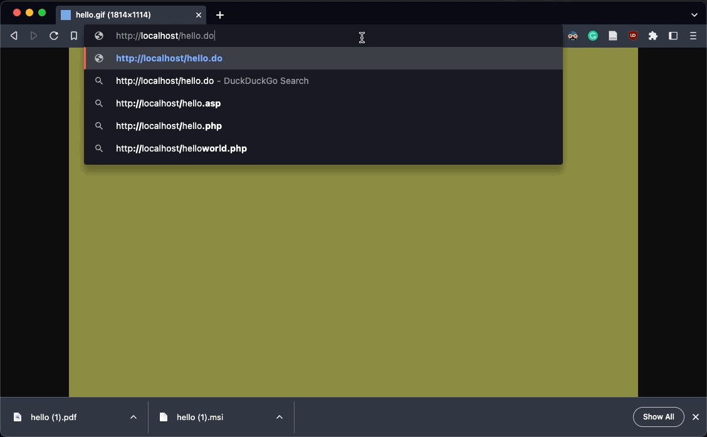

# GHOSTS PANDORA SERVER Overview

???+ info "Pandora is part of GHOSTS"
    [Pandora is within the GHOSTS Source Code Repository](https://github.com/cmu-sei/GHOSTS/tree/master/src/Ghosts.Pandora) hosted on GitHub.

GHOSTS PANDORA is a web server that responds to a myriad of request types with randomized content generated in real-time. It can operate in two modes:

1. **Standard Mode** - Serves randomly-generated content for various file types (HTML, PDF, Office documents, images, etc.)
2. **Social Mode** - Enables POST/PUT/DELETE operations for social media simulation where NPCs can share content, images, and interact with each other

The mode is controlled by configuration, making Pandora a unified content server for all GHOSTS content generation needs. Used in conjunction with [GHOSTS](https://github.com/cmu-sei/GHOSTS) NPCs, Pandora provides agents with realistic content to download, post, and interact with beyond simple HTML and associated image, CSS, and js files.



## Running this server

Pandora runs as a Docker container, either on its own or as part of the GHOSTS stack. Each works with no extra configuration:

| | Standalone | In the GHOSTS stack |
|---|---|---|
| Database | SQLite in `/app/db` | PostgreSQL on `ghosts-postgres`, database `pandora` |
| Activity reporting to the GHOSTS API | off; set `GHOSTS_API_URL` to turn it on | on |
| Address | http://localhost:8000 | http://localhost:8800; `http://ghosts-pandora:5000` on the compose network |

### Standalone

Run the prebuilt image:

```cmd
docker run -d -p 8000:5000 -v pandora-db:/app/db -v pandora-images:/app/wwwroot/images ghcr.io/cmu-sei/ghosts/pandora:latest
```

Or build it from source with the repository's [docker-compose.yml](https://github.com/cmu-sei/GHOSTS/blob/master/src/Ghosts.Pandora/src/docker-compose.yml):

```cmd
git clone https://github.com/cmu-sei/GHOSTS.git
cd GHOSTS/src/Ghosts.Pandora/src
docker compose up -d
```

To report posts, likes and comments to a GHOSTS API as NPC activity, set `GHOSTS_API_URL` (for example `-e GHOSTS_API_URL=http://ghosts-api:5000/api`).

### In the GHOSTS stack

The API's [docker-compose.yml](https://github.com/cmu-sei/GHOSTS/blob/master/src/Ghosts.Api/docker-compose.yml) runs Pandora as the `ghosts-pandora` service, as does the Aspire host. It uses the stack's PostgreSQL, reports activity to `ghosts-api`, and is where the API (`PANDORA_HOST`) and the n8n social workflows (`PANDORA_URL`) post by default.

Set these in the `.env` file next to that compose file to change it:

| Variable | Default | Description |
|----------|---------|-------------|
| `PANDORA_PORT` | `8800` | Host port Pandora is published on |
| `PANDORA_MODE_TYPE` | `social` | `social` or `website` |
| `PANDORA_DEFAULT_THEME` | `facebook` | Theme used in social mode |

See the [Pandora readme](https://github.com/cmu-sei/GHOSTS/blob/master/src/Ghosts.Pandora/readme.md) for all settings.

## Capabilities

### Handling requests by directory

- **/api** - All requests beginning with `/api` automatically respond with json. This includes:
    - `/api/users`
    - `/api/user/a320f971-b3d9-4b79-bb8d-b41d02572942`
    - `/api/reports/personnel`
- **/csv** - All requests beginning with `/csv` automatically respond with csv. Like the above, this includes urls such as:
    - `/csv/users`
    - `/csv/user/winx.jalton`
    - `/csv/reports/HR/payroll`
- **/i, /img, /images** - All requests beginning with these directories automatically respond with a random image of type [gif, jpg, png]. Examples:
    - `/i/v1/a9f6e2b7-636c-4821-acf4-90220f091351/f8f8b1f0-9aa5-4fc7-8880-379e3192748e/small`
    - `/images/products/184f3515-f49b-4e07-8c8b-7f978666df0e/view`
    - `/img/432.png`
- **/pdf** - All requests respond with a random pdf document. Examples:
    - `/pdf/operations/SOP_Vault/a7f48bd5-84cb-43a1-8d3d-cd2c732ddff6`
    - `/pdf/products`
- **/docs** - All requests respond with a random word document
- **/slides** - All requests respond with a random powerpoint document
- **/sheets** - All requests respond with a random excel document

### Handling requests by type

For requests indicating a specific file type, there are several specific handlers built to respond with that particular kind of file, such as:

- .csv
- Image requests [.gif, .ico, .jpg, .jpeg, .png]
- .json
- Office document requests
  - .doc, .docx
  - .ppt, .pptx
  - .xls, .xlsx
- .pdf

So that a URL such as `/users/58361185-c9f2-460f-ac45-cb845ba88574/profile.pdf` would return a pdf document typically rendered right in the browser.

All unhandled request types, urls without a specific file indicator, or requests made outside specifically handled directories (from the preceding section) are returned as html, including:

- `/docs/by_department/operations/users`
- `/blog/d/2022/12/4/blog_title-text`
- `/hello/index.html`

## Social Mode

When configured for social media simulation, Pandora enables NPCs to interact with a realistic social platform. Social mode supports:

| Request                                                                       | Response                                                                      |
| ----------------------------------------------------------------------------- | ------------------------------------------------------------------            |
| `POST` /images                                                                | :material-check: responds with a url to the saved image file                  |
| `POST` /                                                                      | :material-check: responds with a randomly-generated streamed video            |
| `POST` /users/michelle_smith/af2d00aa-4a89-4af3-baff-1746b556e7a1/            | :material-check: responds with a reply to the original user's social post     |

**Configuration:**

Switch between standard and social mode by setting the appropriate environment variables or configuration file settings. See the repository's configuration examples for details on toggling social mode features.

## Hiding malicious payloads for red-teaming

Pandora also can hide payloads in a particular request for things like red-teaming and such. This is done in the configuration file, and looks like this:

```config

[payloads]
1=/1/,a.zip,application/zip
2=/2/users,b.zip,application/zip
3=/3/some/report/url,c.zip,application/zip
```

Each record must be an incrementing integer with no duplication. The values are:

- The URL that this payload responds to
- The local file (stored in `./payloads/`) to be returned
- The MIME type of the response

So for 1 in the example above, requests to /1/ return the a.zip file as an application/zip file.

## Seeding social content and reporting NPC activity

In social mode, posts and profiles can be loaded by script. Both endpoints create the user if it does not exist, and take the theme from the `theme` query parameter, then the `theme` cookie, then `default`.

| Request | Form fields |
| ------- | ----------- |
| `POST` /api/posts | `user`, `message`, and optionally `created` (an ISO-8601 date, UTC unless it carries an offset) to backdate the post and `file` to attach an image |
| `POST` /api/users/{username} | `bio` and `status`; a field that is not sent is left as it was |

```bash
curl -X POST 'http://localhost:5000/api/posts?theme=linkedin' \
  -d user=jsmith -d 'message=Starting a new role this week' -d created=2025-03-01T14:30:00Z

curl -X POST 'http://localhost:5000/api/users/jsmith?theme=linkedin' \
  -d 'bio=Control systems engineer' -d status=Active
```

Sending the same backdated post twice stores it once. The cleanup job removes posts older than `CleanupAge` (60 hours by default), so raise it to keep older history.

When `GHOSTS_API_URL` is set (for example `http://ghosts-api:5000/api`), every post, like, comment and direct message is reported to the GHOSTS API as activity of the NPC that owns the username, found with `GET /api/npcs/lookup?username=`: the username the NPC's machine reports, else the name part of the NPC's email, else `first.last`. Usernames with no NPC are skipped. Reports are sent in the background and carry the time they were sent, so a backdated post is recorded as activity of the moment it was loaded.
